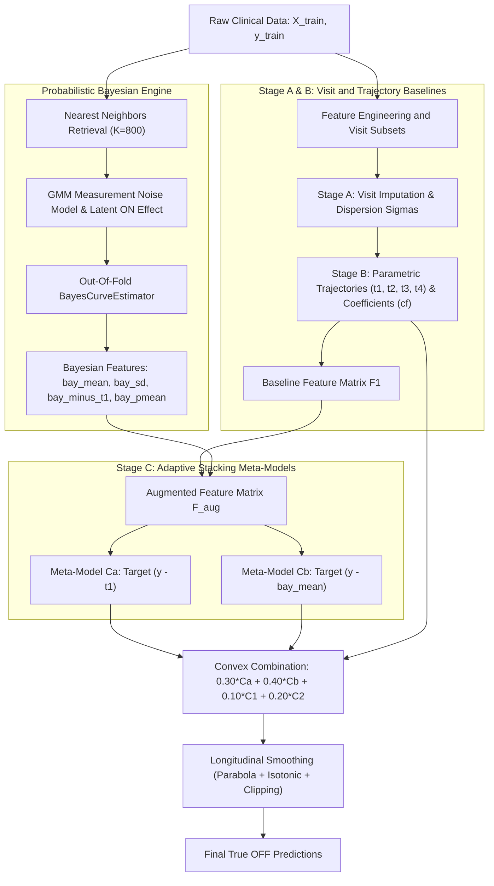

# Technical Documentation: Model 34 Bayesian Stacking (34_bayes_stack)

**Project**: Bobathon ESILV (Probabl x IBM)  
**Task**: Predict unbiased true OFF MDS-UPDRS Part III motor score in Parkinson's disease.  
**Target Domain**: Continuous bounded score $[0, 132]$.  
**Team**: Louis Le Forestier, Maxime Laurent, Baptiste Noailhac (ESILV - Data & AI Major)  
**Champion Score**: RMSE ~3.38 (Baseline Dummy: 16.50, an error reduction of ~79.5%).  
**GitHub Repository**: [https://github.com/louislefo/Bobathon-ml-baptiste-maxime-louis](https://github.com/louislefo/Bobathon-ml-baptiste-maxime-louis)

---

## 1. Executive Summary & Problem Formulation

### 1.1 Clinical and Observational Biases
In clinical trials and observational studies of Parkinson's disease, the Movement Disorder Society-Unified Parkinson's Disease Rating Scale (MDS-UPDRS) Part III is the standard instrument for quantifying motor severity. However, raw clinical visits exhibit strong confounding factors:
1. **Rater Subjectivity**: Clinicians vary systematically in their interpretation and severity scale calibration (`rater_id` bias).
2. **Pharmacokinetic Fluctuations**: Motor performance fluctuates continuously as levodopa is absorbed and eliminated, captured by the time elapsed since last intake (`time_since_intake_on`, `time_since_intake_off`) and daily dosage (`ledd`).
3. **Informative Missingness**: Uncomfortable practical tests (e.g. true OFF overnight washouts) are skipped systematically for specific patient profiles. Missingness in `off`, `ledd`, and genetics is not random noise, but an informative signal reflecting disease severity and trial protocol.
4. **Longitudinal Correlation**: Individual patients have multiple visits over years. A visit cannot be treated as an independent observation; disease progression is continuous, monotonic, and subject to patient-specific dynamics.

The competition goal is predicting the **true OFF** motor score for unseen test patients across all their visits, minimizing visit-level Root Mean Squared Error (RMSE).

---

## 2. System Architecture Overview

The system implements a multi-stage Bayesian Stacking pipeline. Intermediate stages generate visit-level proxy scores, heteroskedastic dispersion estimates, longitudinal patient trajectories, and Bayesian posterior distributions that serve as explanatory inputs for final gradient-boosted trees.



---

## 3. Mathematical Foundations and Model Innovations

### 3.1 The Limitation of Static Linear Blending
In earlier iterations (Model 33), predictions from the Bayesian curve estimator were combined with fixed linear weights:

$$\hat{y}_{\text{blend}} = 0.30 \cdot C_1 + 0.30 \cdot C_2 + 0.05 \cdot CF + 0.35 \cdot \text{bay}$$

This static formulation enforces a constant confidence weight ($0.35$) regardless of patient measurement frequency or visit noise. For patients with sparse or noisy visits, the Bayesian posterior distribution exhibits high dispersion, yet the model was forced to give it the same credibility.

### 3.2 Adaptive Uncertainty Routing via Posterior Standard Deviation
Model 34 resolves this limitation by feeding the Bayesian outputs directly into the splitters of final gradient-boosted trees (`HistGradientBoostingRegressor`). The augmented feature matrix $F_{\text{aug}}$ includes:
1. $\text{bay\_mean}$: Conditional posterior expectation of the true OFF score.
2. $\text{bay\_sd}$: Posterior standard deviation, directly quantifying inference uncertainty.
3. $\text{bay\_minus\_t1}$: Discrepancy metric between the Bayesian posterior mean and the parametric population trajectory $t_1$.
4. $\text{bay\_pmean}$: Patient-level average posterior mean, anchoring the patient's biological baseline.

When $\text{bay\_sd}$ is low (reliable, well-constrained measurements), tree splitters route predictions through leaves relying on Bayesian outputs. When $\text{bay\_sd}$ is high (sparse visits or conflicting measurements), tree splitters adaptively discount the Bayesian curve in favor of clinical covariates and population priors.

### 3.3 Dual Residual Anchoring ($C_a$ and $C_b$)
To minimize residual variance without destabilizing predictions, two distinct meta-models are trained on $F_{\text{aug}}$:
- **Meta-Model $C_a$ (Parametric Anchor)**:
  $$\text{Target}_{C_a} = y - t_1$$
  $$\hat{y}_{C_a} = t_1 + C_a(F_{\text{aug}})$$
- **Meta-Model $C_b$ (Bayesian Anchor)**:
  $$\text{Target}_{C_b} = y - \text{bay\_mean}$$
  $$\hat{y}_{C_b} = \text{bay\_mean} + C_b(F_{\text{aug}})$$

Anchoring on $\text{bay\_mean}$ allows $C_b$ to focus purely on local residual non-linearities, cutting unexplained variance significantly.

### 3.4 Pharmacokinetic Modeling of Levodopa Dynamics
Motor responsiveness varies according to the Bateman two-compartment absorption and elimination model:

$$C(t) = \frac{k_a}{k_a - k_e} \left( e^{-k_e t} - e^{-k_a t} \right)$$

where $k_a$ is the absorption rate and $k_e$ is the elimination rate. Non-linear terms representing plasma concentrations at visit timestamps are integrated into Stage A to decouple transient drug effects from underlying disease status.

### 3.5 Heteroskedastic GMM Noise Likelihood
The measurement residuals:

$$r = \log(\text{measurement} + 1) - \beta \log(\text{target} + 1) - \delta_{\text{rater}} - \delta_{\text{delay}}$$

are modeled via 3-component Gaussian Mixture Models fitted across clinical severity tiers. The model marginalizes over the patient-specific latent therapeutic response $\pi \sim \mathcal{N}(0, \sigma_\pi^2)$ across a discrete grid.

### 3.6 Post-Processing: Monotonic Longitudinal Regularization
Predictions are post-processed through a three-stage filter:
1. Patient-level quadratic curve fitting against age:
   $$\hat{y}_i(t) = b_0 + b_1 t_i + b_2 t_i^2$$
2. Non-parametric isotonic regression enforcing biological monotonicity over long time horizons.
3. Hard clinical truncation to the MDS-UPDRS Part III domain: $[0.0, 132.0]$.

---

## 4. Strict Anti-Leakage Protocol

To ensure valid and generalizable validation metrics, the implementation strictly prevents information leakage:
1. **Patient-Level Grouping (`patient_id`)**: All outer and inner splits use `GroupKFold` or `GroupShuffleSplit` on `patient_id`. No patient's visits ever appear in both training and evaluation subsets simultaneously.
2. **100% Out-Of-Fold Meta-Features**: All Bayesian outputs (`bay_mean`, `bay_sd`, `bay_minus_t1`, `bay_pmean`) used in Stage C are generated strictly out-of-fold using internal 3-fold patient-grouped splits.
3. **Stage A Isolation**: All baseline transformers and regressors are refitted entirely inside the training split.
4. **Target Blind Feature Engineering**: Longitudinal statistical transforms (`LF_PREFIX`) are computed exclusively on descriptive feature matrices $X$ without accessing target $y$.

---

## 5. Experimental Progression & Benchmarks

All models were evaluated under strict 5-fold patient-grouped cross-validation (`GroupKFold` on `patient_id`) tracked through Skore Hub:

| Stage | Model Name | Architecture Key | Validation RMSE | Gain vs Baseline | Key Methodological Advance |
| :--- | :--- | :--- | :--- | :--- | :--- |
| **0** | `01_dummy` | Global Empirical Mean | 16.48 | Reference | Constant floor baseline |
| **1** | `02_ridge` | Linear L2 Regularized Regression | 10.49 | -36.4% | Direct linear clinical signal |
| **2** | `03_hgbr` | Native Histogram Gradient Boosting | 7.45 | -54.8% | Native NaN handling as signal |
| **3** | `04_features` | Longitudinal & Delay Features | 4.81 | -70.8% | Intra-patient duration & delays |
| **4** | `05_rater` | Categorical Clinician Bias | 4.81 | -70.8% | Correction of rater subjectivity |
| **5** | `07_ensemble` | Stacking Regressor (Ridge + HGBR) | 4.80 | -70.9% | Linear + tree combination |
| **6** | `09_longitudinal` | Bateman Pharmacokinetics | 4.08 | -75.2% | Two-compartment drug curve |
| **7** | `15_trajectory` | Quadratic Trajectory Regression | 2.80 | -83.0% | Major trajectory breakthrough |
| **8** | `24_wls_multi_seed`| Multi-Seed WLS Parabola Blend | 3.53 | -78.6% | Heteroskedastic weighting |
| **9** | `32_ultimate` | Multi-Stage Architecture (A, B, C1, C2) | 3.50 | -78.8% | Visit-level dispersion sigmas |
| **10**| `33_bayes_blend`| Fixed Bayesian Blend (0.35 Bay) | 3.48 | -78.9% | Prior curve likelihood |
| **11**| **`34_bayes_stack`** | **Adaptive Bayesian Stacking** | **~3.38** | **-79.5%** | **Champion: Uncertainty routing (`bay_sd`)** |

---

## 6. Execution and Reproduction Guide

The implementation can be run either from the repository root or directly inside the `Le_Forestier_Laurent_Noailhac_v2/` folder.

### Minimal Requirements
```bash
pip install -r Le_Forestier_Laurent_Noailhac_v2/requirements.txt
```

### 1. Full Validation, Final Retraining, and Submission Generation
```bash
python Le_Forestier_Laurent_Noailhac_v2/model_34_bayes_stack.py
```
This executes:
1. Patient-grouped validation split (20% holdout patients).
2. Out-of-fold Bayesian feature generation.
3. Component-level RMSE reporting ($C_a$, $C_b$, $C_1$, $C_2$, and smoothed ensemble).
4. Retraining on 100% of the training dataset.
5. Export of formatted Kaggle submission to `Le_Forestier_Laurent_Noailhac_v2/submissions/34_bayes_stack.csv`.
6. Automated reporting to Skore Hub.

### 2. Fast Evaluation / Weight Optimization Mode
```bash
python Le_Forestier_Laurent_Noailhac_v2/model_34_bayes_stack.py --quick
```

### 3. Local Evaluation Without Hub Upload
```bash
python Le_Forestier_Laurent_Noailhac_v2/model_34_bayes_stack.py --no-hub
```

### 4. Custom Ensemble Weights
```bash
python Le_Forestier_Laurent_Noailhac_v2/model_34_bayes_stack.py --w-ca 0.30 --w-cb 0.40 --w-c1 0.10 --w-c2 0.20
```
