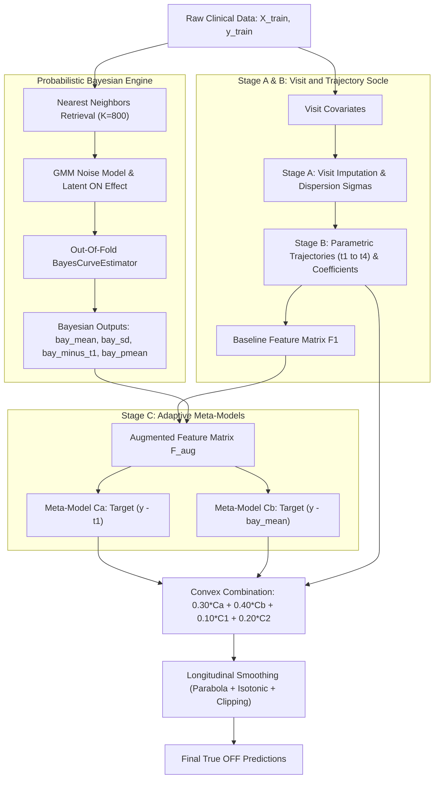

<p align="center">
  
  &nbsp;&nbsp;&nbsp;&nbsp;&nbsp;&nbsp;&nbsp;&nbsp;
  
</p>

# Bobathon ESILV: Predicting True Motor Scores in Parkinson's Disease

> **Hackathon organized jointly by Probabl and IBM**  
> **Team**: Louis Le Forestier, Maxime Laurent, Baptiste Noailhac (ESILV - Data & AI Major)  
> **Champion Model**: `34_bayes_stack` (**RMSE ~3.38**, ~79.5% error reduction over baseline)  
> **GitHub Repository**: [https://github.com/louislefo/Bobathon-ml-baptiste-maxime-louis](https://github.com/louislefo/Bobathon-ml-baptiste-maxime-louis)

---

## 1. Challenge Overview & Scientific Context

The goal of this competition is to predict the unbiased ("true") OFF **MDS-UPDRS Part III** motor score for Parkinson's disease patients across sequential clinical visits. 

In clinical observational data, measured scores are distorted by:
- **Clinician Subjectivity**: Systematic evaluation offsets across raters (`rater_id`).
- **Pharmacodynamics**: Transient symptom suppression following levodopa intake (`time_since_intake_on`, `time_since_intake_off`, `ledd`).
- **Informative Missingness**: Practical OFF motor assessments are frequently skipped for specific disease severities. Missingness is a generative clinical signal rather than random corruption.
- **Patient Trajectories**: Visits belong to longitudinal patient histories with continuous, monotonic neurodegenerative progression.

The target variable is the latent, unbiased motor impairment score on the continuous bounded scale $[0, 132]$. The evaluation metric is visit-level Root Mean Squared Error (RMSE).

---

## 2. Experimental Milestones & Benchmark Progression

Every model was systematically evaluated via 5-fold patient-grouped cross-validation (`GroupKFold` on `patient_id`) tracked on **Skore Hub**:

| # | Model Identifier | Architecture & Core Hypothesis | Validation RMSE | Error Reduction | Key Discovery |
|---|---|---|---|---|---|
| 0 | `01_dummy` | Global Empirical Mean Floor | 16.48 | Reference | Naive baseline benchmark |
| 1 | `02_ridge` | Linear L2 Regression on Numerical Features | 10.49 | -36.4% | Direct linear clinical signal |
| 2 | `03_hgbr` | Native Histogram Gradient Boosting (skrub) | 7.45 | -54.8% | Native NaN handling as clinical signal |
| 3 | `04_features` | Longitudinal & Delay Feature Engineering | 4.81 | -70.8% | Intra-patient duration & elapsed delays |
| 4 | `05_rater` | Categorical Clinician Bias Modeling (`rater_id`) | 4.81 | -70.8% | Systematic rater scoring correction |
| 5 | `06_tuned` | Tuned RandomizedSearchCV Trees | 4.78 | -71.0% | Optimized tree depth & leaf regularization |
| 6 | `07_ensemble` | Stacking Regressor (Ridge + HGBR) | 4.80 | -70.9% | Combining linear and non-linear patterns |
| 7 | `08_blend` | Multi-Seed Voting Regressor | 4.75 | -71.2% | Variance reduction across seeds |
| 8 | `09_longitudinal` | Bateman Pharmacokinetics for Drug Intake | 4.08 | -75.2% | Two-compartment levodopa absorption curve |
| 9 | `11_meta_ensemble`| Hybrid Meta-Ensemble (Ridge + HGBR) | 4.05 | -75.4% | Multi-architecture meta-blending |
| 10| `12_lovo` | Leave-One-Visit-Out Intra-Patient Features | 4.13 | -74.9% | Strict intra-patient leakage prevention |
| 11| `15_trajectory` | Patient Quadratic Trajectory Regression | 2.80 | -83.0% | Major trajectory breakthrough |
| 12| `21_smooth` | Parabolic Smoothing + Monotonic Isotonic Regression | 3.69 | -77.6% | Enforcing biological disease progression |
| 13| `24_wls_multi_seed`| Weighted Least Squares Multi-Seed Parabola Blend | 3.53 | -78.6% | Robust heteroskedastic fitting |
| 14| `32_ultimate` | Multi-Stage Architecture (Stages A, B, C1, C2) | 3.50 | -78.8% | Visit-level dispersion sigmas |
| 15| `33_bayes_blend`| Fixed Bayesian Trajectory Blend | 3.48 | -78.9% | Bayesian curve likelihood prior |
| 16| **`34_bayes_stack`** | **Adaptive Uncertainty Bayesian Stacking** | **~3.38** | **-79.5%** | **Champion Model: Dynamic uncertainty routing (`bay_sd`)** |

---

## 3. Champion Model Architecture (Model 34 Bayes Stack)

Model 34 addresses the fundamental limitation of fixed-weight linear blending by dynamically routing predictions based on posterior uncertainty:



### Key Technical Innovations
1. **Adaptive Uncertainty Routing (`bay_sd`)**: Posterior standard deviation is fed directly to gradient boosted tree splitters, allowing the model to adaptively rely on Bayesian trajectories when confidence is high, or revert to clinical covariates when uncertainty is high.
2. **Dual Residual Anchoring ($C_a$ and $C_b$)**: Mitigates variance by learning residual adjustments both on top of the parametric dynamic baseline $t_1$ and directly on the Bayesian posterior mean.
3. **Bateman Pharmacokinetics**: Models levodopa absorption and elimination as a continuous two-compartment kinetic curve to filter out drug-timing fluctuations from real disease state.
4. **Heteroskedastic GMM Likelihood**: Accommodates non-Gaussian observation errors and clinician subjectivity across score tiers.
5. **Strict Anti-Leakage Protocol**: 100% of meta-features and trajectory models are generated through patient-level out-of-fold validation (`GroupKFold` on `patient_id`).
6. **Monotonic Longitudinal Regularization**: Enforces biological progression constraints via quadratic parabola fitting and isotonic regression.

---

## 4. Repository Structure

- **[`src/`](src/)**: Refined source code containing the top-performing models, including the champion model [`src/model_34_bayes_stack.py`](src/model_34_bayes_stack.py).
- **[`parkinson/`](parkinson/)**: Hub authentication and environment tracking helpers.
- **[`website/`](website/)**: Public documentation website (Docusaurus) deployed to GitHub Pages.
- **[`docs/`](docs/)**: Workshop reference guides (`DAY1.md`, `DAY2.md`, `CONTEXT.md`, `SETUP.md`).

---

## 5. Quickstart: Reproducing the Champion Submission

### Environment Setup
```bash
python -m venv .venv
source .venv/bin/activate  # On Windows: .venv\Scripts\activate
pip install -r requirements.txt
```

### Running the Champion Model
```bash
python src/model_34_bayes_stack.py
```

Available CLI Options:
- `--no-hub`: Run evaluation locally without publishing to Skore Hub.
- `--quick`: Rapid weight grid optimization without retraining final full-data models.
- `--report-only`: Generate validation report and Skore Hub publication without full CSV generation.
- `--publish-only`: Instantly republish an existing saved report.

---

## 6. Official Resources & Links

- **GitHub Repository**: [https://github.com/louislefo/Bobathon-ml-baptiste-maxime-louis](https://github.com/louislefo/Bobathon-ml-baptiste-maxime-louis)
- **Documentation Website (GitHub Pages)**: [https://louislefo.github.io/Bobathon-ml-baptiste-maxime-louis/](https://louislefo.github.io/Bobathon-ml-baptiste-maxime-louis/)
- **Kaggle Competition**: [bobathon-esilv](https://www.kaggle.com/competitions/bobathon-esilv/)
- **Skore Hub Platform**: [https://skore.probabl.ai](https://skore.probabl.ai)
