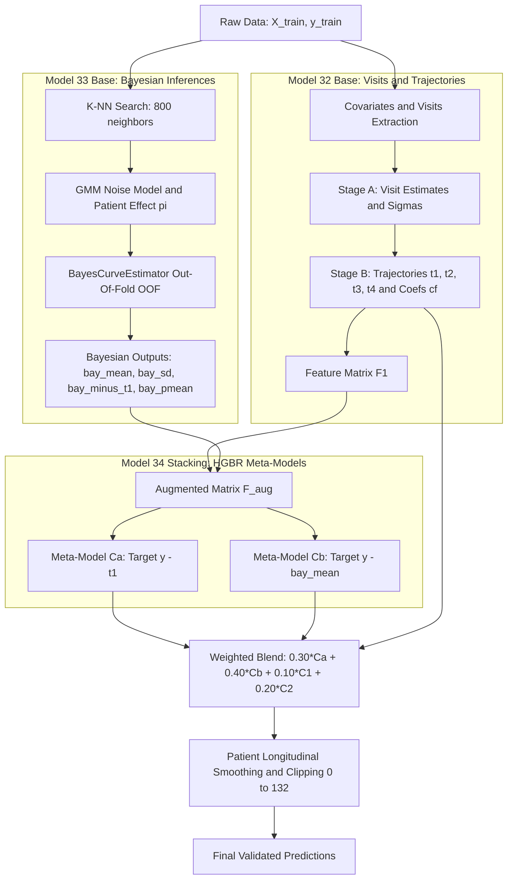

# Technical Documentation: Model 34 Bayes Stack (34_bayes_stack)

Project: Bobathon ESILV (Probabl x IBM)  
Prediction Target: MDS-UPDRS Part III motor score (continuous variable, domain [0, 132]).

---

## 1. System Architecture Overview (Mermaid)

The flowchart below illustrates the full multi-stage architecture of Model 34, integrating foundational components from Models 32 and 33 into an uncertainty-aware Bayesian Stacking framework with dual residual anchors:



---

## 2. Core Intuition and Theoretical Rationale

### 2.1 The limitation of static linear blending (Model 33)
In Model 33, predictions from the Bayesian curve estimator were combined linearly using constant weights:

```text
pred_blend = 0.30 * C1 + 0.30 * C2 + 0.05 * CF + 0.35 * bay
```

This rigid weighting scheme assigns the exact same credibility weight (0.35) to the Bayesian estimate across all patients, regardless of measurement reliability or missingness. Whenever a patient has sparse or noisy clinical visits, the Bayesian estimator suffers from elevated uncertainty, yet its fixed contribution remains unchanged.

### 2.2 Why Bayesian Stacking (Model 34) achieves a ~0.10 RMSE breakthrough
Model 34 transforms Bayesian posterior outputs into **explanatory input features** for final gradient-boosted trees (HistGradientBoostingRegressor):
1. **Uncertainty-Aware Adaptive Weighting (`bay_sd`)**: By exposing `bay_sd` directly to the tree splitters, the boosting algorithm learns when to rely on the Bayesian curve (when uncertainty is low) and when to fall back on visit-level stages $C_1$ and $C_2$ (when uncertainty is high).
2. **Cross-Model Discrepancy Signal (`bay_minus_t1`)**: Captures tension between parametric population dynamics ($t_1$) and Bayesian likelihood-based trajectories.
3. **Dual Residual Anchoring ($C_a$ and $C_b$)**:
   - $C_a$ retains the parametric trajectory baseline $t_1$ and uses Bayesian signals to refine adjustments.
   - $C_b$ anchors directly onto the posterior expectation `bay_mean` and learns residual corrections on top of this non-linear foundation, substantially cutting residual variance.

---

## 3. Step-by-Step Pipeline Description

### Step 1: Stage A (Visit-Level Imputation and Scoring)
Inherited from `UltimateRegressor` (Model 32):
- Splits observations into three feature subsets: full covariates, covariates without motor scores, and demographic variables.
- Predicts visit-level proxy scores (`est_visit`, `est_off`, `est_on`) alongside heteroskedastic dispersion parameters ($\sigma$) to quantify clinical exam reliability.

### Step 2: Stage B (Longitudinal Patient Trajectories)
- Constructs 4 parametric patient trajectories ($t_1, t_2, t_3, t_4$) combining historical visits with an empirical population prior.
- Regresses patient-specific quadratic trajectory coefficients $cf$ ($b_0, b_1, b_2$) to capture disease progression dynamics.
- Assembles feature matrix $F_1$.

### Step 3: Out-Of-Fold Bayesian Curve Estimation (`BayesCurveEstimator`)
To prevent target leakage, internal `GroupKFold(n_splits=3)` grouped by patient is enforced:
- Evaluates candidate trajectories from 800 nearest neighbors (K-NN).
- Employs a 3-component Gaussian Mixture Model (GMM) calibrated across score bands, rater biases, and intake delays to evaluate the log-likelihood of OFF/ON states.
- Marginalizes over patient therapeutic response factor $\pi$.
- Emits 4 out-of-fold Bayesian features:
  - `bay_mean`: conditional posterior expectation.
  - `bay_sd`: posterior standard deviation (uncertainty metric).
  - `bay_minus_t1`: difference `bay_mean - t1_oof`.
  - `bay_pmean`: intra-patient mean of `bay_mean`.

### Step 4: Augmented Meta-Stages ($C_a$ and $C_b$)
Feature matrix $F_1$ is concatenated with these 4 columns to produce $F_{\text{aug}}$. Two HGBR models are trained:
- **$C_a$ Model**: Target is $y - t_1$. Prediction: $\hat{y}_{C_a} = t_1 + C_a(F_{\text{aug}})$.
- **$C_b$ Model**: Target is $y - \text{bay\_mean}$. Prediction: $\hat{y}_{C_b} = \text{bay\_mean} + C_b(F_{\text{aug}})$.

### Step 5: Final Ensemble and Longitudinal Post-Processing
The raw ensemble combines all 4 stages:

```text
pred_raw = 0.30 * Ca + 0.40 * Cb + 0.10 * C1 + 0.20 * C2
```

Predictions are subsequently refined via `smooth_predictions` (`src/model_21_smooth.py`):
1. Patient-level quadratic curve fitting against age.
2. Isotonic regression enforcing biological monotonicity.
3. Hard bounding to the valid clinical scale: $[0.0, 132.0]$.

---

## 4. Strict Anti-Leakage Protocol

1. **Patient-Level Grouping (`patient_id`)**: No patient visits are ever split across train and validation folds.
2. **100% Out-Of-Fold Feature Engineering**: Meta-features are generated exclusively from models trained on out-of-fold subsets.
3. **Internal Stage A Re-Fitting**: Baseline estimators are retrained inside each outer fold.

---

## 5. Execution Guide

Run from the project root using the project virtual environment:

### Full Evaluation and Submission Generation:
```powershell
python rendu/model_34_bayes_stack.py
```
Available CLI options:
- `--no-hub`: Disables upload to Skore Hub.
- `--quick`: Runs 2-pass out-of-fold weight grid search only.
- `--report-only`: Computes and publishes validation report without final retraining.
- `--publish-only`: Uploads existing joblib report directly without recomputing.
- `--w-ca`, `--w-cb`, `--w-c1`, `--w-c2`: Custom ensemble weights.

### Quick Weight Optimization Mode:
```powershell
python rendu/model_34_bayes_stack.py --quick
```
