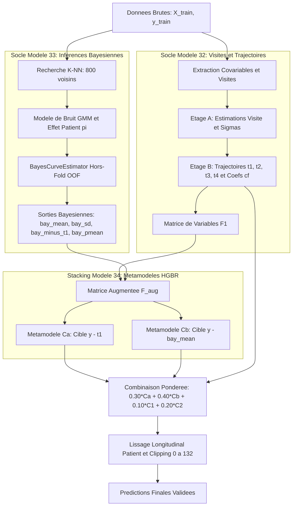

# Documentation Complete : Modele 34 Bayes Stack (34_bayes_stack)

Projet : Bobathon ESILV (Probabl x IBM)  
Cible de prediction : Score moteur MDS-UPDRS Part III (variable continue, intervalle [0, 132]).

---

## 1. Schema d'Architecture General (Mermaid)

Le flux ci-dessous illustre l'architecture complete du Modele 34, integrant les composantes issues des modeles 32 et 33 dans une structure de Stacking a double ancre residuelle :



---

## 2. Intuition et Fondements Theoriques

### 2.1 La limite du blend lineaire fixe (Modele 33)
Dans le Modele 33, la prediction issue de l'estimateur de courbe bayesienne etait combinee de maniere rigide avec les etages $C_1$ et $C_2$ :
$$\text{pred}_{\text{blend}} = 0.30 \cdot C_1 + 0.30 \cdot C_2 + 0.05 \cdot CF + 0.35 \cdot \text{bay}$$

Cette approche attribue exactement le meme coefficient de confiance (0.35) a l'estimateur bayesien pour tous les patients, qu'ils disposent de mesures fiables ou non. Lorsqu'un patient presente des donnees lacunaires ou aberrantes, l'estimateur bayesien a une forte incertitude mais son poids dans le melange reste inchange.

### 2.2 Pourquoi le Stacking Bayesien (Modele 34) ameliore le score de ~0.10 RMSE
Le Modele 34 transforme les sorties bayesiennes en **variables explicatives** destinees a des arbres de gradient boosting (HGBR) :
1. **L'incertitude explicite (`bay_sd`)** : En apprenant sur `bay_sd`, l'arbre determine lui-meme quand s'appuyer sur la forme bayesienne (si l'incertitude est faible) et quand s'en detourner pour privilegier les etages $C_1$ et $C_2$ (si l'incertitude est forte).
2. **Signal d'ecart inter-modeles (`bay_minus_t1`)** : Capture la tension entre la dynamique de cohorte parametrée ($t_1$) et la distribution bayesienne issue de la vraisemblance.
3. **Double ancre de residus ($C_a$ et $C_b$)** :
   - $C_a$ conserve le point d'ancrage classique $t_1$ et utilise les variables bayesiennes pour affiner les corrections.
   - $C_b$ utilise directement l'esperance bayesienne `bay_mean` comme point d'ancrage et apprend a corriger ses residus. L'arbre demarre d'une base non-lineaire deja tres fidele a la realite clinique, ce qui reduit drastiquement la variance residuelle.

---

## 3. Description Etape par Etape du Pipeline

### Etape 1 : Etage A (Niveau Visite)
Herite de `UltimateRegressor` (Modele 32) :
- Decoupage des observations en trois matrices : covariables completes, sans mesures motrices, et variables sociodemographiques.
- Estimation d'un score de visite `est_visit`, `est_off`, `est_on`, ainsi que des sigmas de dispersion residuelle pour mesurer la fiabilite de chaque examen clinique.

### Etape 2 : Etage B (Trajectoires Longitudinales)
- Construction de 4 trajectoires parametrées par patient ($t_1, t_2, t_3, t_4$) integrant l'historique temporel et un a priori de population.
- Regression des coefficients de tendance $cf$ ($b_0, b_1, b_2$) ajustee sur les visites disponibles de chaque individu.
- Generation de la matrice de variables $F_1$.

### Etape 3 : Estimation de Courbes Bayesiennes Hors-Fold (`BayesCurveEstimator`)
Pour eviter toute fuite d'information (data leakage), un partitionnement interne `GroupKFold(n_splits=3)` par patient est utilise :
- Sur chaque sous-pli d'entrainement, les trajectoires de 800 voisins K-NN sont evaluees.
- Un modele de bruit base sur des melanges de gaussiennes (GMM a 3 composantes) et tenant compte des decalages d'evaluateurs et de delais de prise medicamenteuse evalue la log-vraisemblance des mesures off et on.
- Marginalisation d'un effet therapeutique patient $\pi$.
- Generation des 4 variables bayesiennes sur le sous-pli de validation :
  - `bay_mean` : esperance conditionnelle a posteriori.
  - `bay_sd` : incertitude locale (ecart-type a posteriori).
  - `bay_minus_t1` : difference `bay_mean - t1_oof`.
  - `bay_pmean` : moyenne intra-patient des `bay_mean`.

### Etape 4 : Etages Finaux Augmentes (Metamodeles Ca et Cb)
La matrice $F_1$ est augmentee de ces 4 colonnes pour former $F_{\text{aug}}$. Deux regresseurs HGBR sont entraines :
- **Ca** : Cible $y - t_1$. Prediction finale : $\hat{y}_{C_a} = t_1 + C_a(F_{\text{aug}})$.
- **Cb** : Cible $y - \text{bay\_mean}$. Prediction finale : $\hat{y}_{C_b} = \text{bay\_mean} + C_b(F_{\text{aug}})$.

### Etape 5 : Blend Final et Post-Traitement
La combinaison finale pondere les 4 etages :
$$\hat{y}_{\text{brut}} = 0.30 \cdot \hat{y}_{C_a} + 0.40 \cdot \hat{y}_{C_b} + 0.10 \cdot \hat{y}_{C_1} + 0.20 \cdot \hat{y}_{C_2}$$

Un lissage longitudinal par patient est applique via la fonction `smooth_predictions` :
1. Regression parabolique par patient selon l'age.
2. Regression isotonique garantissant l'absence de fluctuations erratiques non biologiques.
3. Troncation stricte dans l'intervalle valide de l'echelle : $[0, 132]$.

---

## 4. Prevention des Fuites de Donnees (Data Leakage)

1. **Groupement strict par patient (`patient_id`)** : Aucune observation d'un patient n'est partagee entre un pli d'entrainement et un pli de test ou de validation.
2. **Sorties bayesiennes 100% hors-fold** : Le modele bayesien utilise en covariable d'apprentissage n'a jamais vu la cible des lignes pour lesquelles il genere des predictions.
3. **Reconstruction complete de l'etage A** : Les modeles d'imputation de visite sont reaffectes et reentraines au sein de chaque pli externe.

---

## 5. Guide d'Execution

Depuis la racine du projet avec l'environnement virtuel active :

### Evaluation complete et generation de soumission :
```powershell
python rendu/model_34_bayes_stack.py
```
Options disponibles :
- `--no-hub` : Desactive l'envoi vers Skore Hub.
- `--quick` : Execute uniquement l'optimisation de la grille de poids OOF en 2 passes.
- `--report-only` : Calcule et publie le rapport d'evaluation sans entrainement final de soumission.
- `--publish-only` : Republie instantanement le dernier rapport sans recalcul.
- `--w-ca`, `--w-cb`, `--w-c1`, `--w-c2` : Personnalisation des poids du melange.

### Execution rapide sur grille de poids :
```powershell
python rendu/model_34_bayes_stack.py --quick
```
