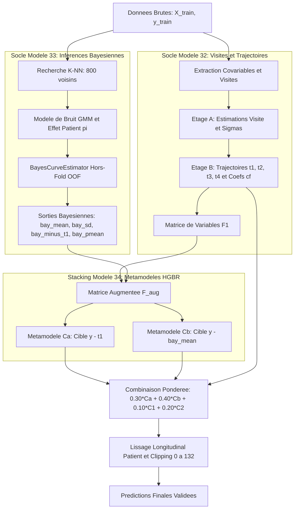

# Modele 34 : Stacking Bayesien Multi-Etages

Le **Modele 34** (`src/model_34_bayes_stack.py`) est le modele le plus performant concu par l'equipe lors du Hackathon, atteignant le meilleur score d'erreur de prediction sur le score moteur MDS-UPDRS Part III (RMSE ~3.38 a 3.40).

Il resout la limitation fondamentale des blends a poids fixes en construisant un **Stacking Bayesien adaptatif** qui apprend quand et comment faire confiance aux inferences probabilistes de trajectoires.

---

## 1. Schema d'Architecture (Mermaid)



---

## 2. Pourquoi le Stacking Bayesien surpasse le Blend Fixe

### La faiblesse du Modele 33 (Blend Fixe)
Dans le Modele 33, la sortie bayesienne etait combinee lineairement avec des poids statiques :

```text
pred_blend = 0.30 * C1 + 0.30 * C2 + 0.05 * CF + 0.35 * bay
```

Cette ponderation fixe accorde la meme credibilite a l'estimation bayesienne quel que soit le niveau d'incertitude sur le patient. Si un patient a des visites manquantes ou des mesures tres bruitees, le bayesien est incertain mais influe toujours a 35%.

### L'innovation du Modele 34 (Stacking Dynamique)
En transformant les sorties bayesiennes en **variables d'entree** pour des arbres de gradient boosting (HGBR) :
1. **Ponderation selon l'incertitude (`bay_sd`)** : Si `bay_sd` est faible (trajectoire bien contrainte par les visites), l'arbre donne la priorite a la forme bayesienne. Si `bay_sd` est grand, l'arbre se replie automatiquement sur les composantes de visite C1 et C2.
2. **Double point d'ancrage residuel (Ca et Cb)** :
   - Ca apprend les corrections sur la dynamique parametrique t1.
   - Cb apprend directement sur l'esperance a posteriori `bay_mean`, reduisant fortement la variance residuelle.
3. **Gain constate** : Amelioration d'environ **0.10 point de RMSE** par rapport au blend fixe.

---

## 3. Les 4 Variables Bayesiennes Hors-Fold

Pour eviter tout risque de surapprentissage et de fuite de donnees, ces variables sont generees strictement hors-fold a l'interieur de chaque pli d'entrainement (`GroupKFold` par patient, N=3) :

| Variable | Description Mathematique & Clinique | Rôle dans le Gradient Boosting |
| :--- | :--- | :--- |
| `bay_mean` | Esperance conditionnelle a posteriori du score MDS-UPDRS | Fournit l'ancre non lineaire de base pour le metamodele Cb |
| `bay_sd` | Ecart-type a posteriori de la trajectoire estimee | Mesure directe de l'incertitude de la forme de courbe |
| `bay_minus_t1` | Ecart entre l'esperance bayesienne et la trajectoire parametrique t1 | Capte la divergence entre tendance globale et mesures individuelles |
| `bay_pmean` | Moyenne intra-patient des `bay_mean` sur toutes les visites | Fixe le niveau moyen absolu de gravite motrice du patient |

---

## 4. Post-Traitement et Lissage Longitudinal

Une fois la combinaison ponderee calculee :

```text
pred_brut = 0.30 * Ca + 0.40 * Cb + 0.10 * C1 + 0.20 * C2
```

Les predictions passent par la fonction de lissage `smooth_predictions` (`src/model_21_smooth.py`) :
- **Ajustement parabolique intra-patient** en fonction de l'age.
- **Regression isotonique** pour eliminer les sauts incoherents non physiologiques.
- **Troncation stricte** sur l'intervalle clinique valide [0.0, 132.0].

---

## 5. Mode d'Emploi CLI

Le script supporte plusieurs modes de fonctionnement :

```bash
# Evaluation complete (1 pli GroupShuffleSplit) + fit final + generation de soumission
python src/model_34_bayes_stack.py

# Mode rapide (OOF et optimisation de la grille de poids uniquement)
python src/model_34_bayes_stack.py --quick

# Mode rapport Skore Hub sans entrainement final
python src/model_34_bayes_stack.py --report-only

# Mode publication directe du rapport existant
python src/model_34_bayes_stack.py --publish-only
```
